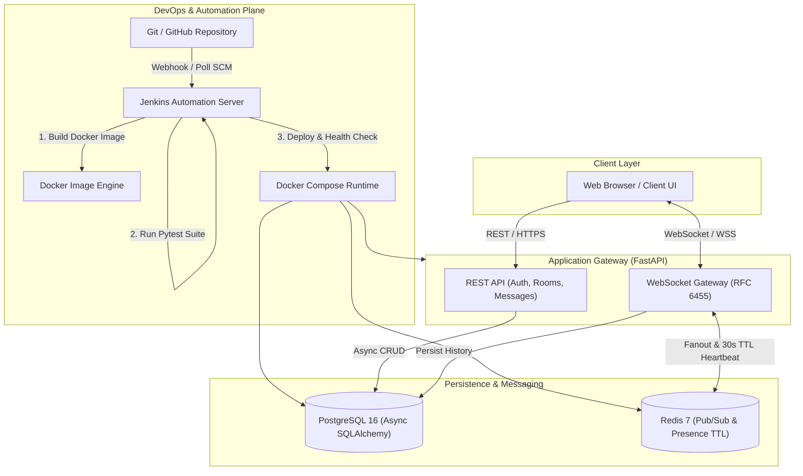

# 🚀 Project Presentation Summary — BaatCheet (बातचीत)

> **Course**: DevOps & Continuous Delivery (BCS-601)  
> **Institution**: Department of Computer Science & Engineering, K. R. Mangalam University, Gurugram  
> **Student Name**: Komal  
> **Roll Number**: 2301730038  
> **Project Name**: **BaatCheet** — Cloud-Native Real-Time Chat Platform & Automated CI/CD Pipeline  

---

## 📌 1. High-Level Project Elevator Pitch (What to Say in 60 Seconds)

> *"Good morning respected faculty and colleagues. My project is **BaatCheet**, a high-performance, cloud-native real-time chat platform engineered with **FastAPI**, **Redis Pub/Sub**, and **PostgreSQL**, completely automated through a robust **Jenkins CI/CD pipeline** and **Docker containerization**.*
>
> *In traditional chat applications, HTTP polling creates severe latency, and single-server WebSockets fail when scaled horizontally. Furthermore, manual software deployments lead to configuration drift, downtime, and human error.*
>
> *To solve this, I designed BaatCheet from the ground up: starting from strict **Git version control** and **asynchronous backend architecture**, through **multi-stage Docker containerization**, all the way to a fully automated **Declarative Jenkins Pipeline** that automatically builds, tests, deploys, verifies health with automated rollbacks, and triggers on every Git push without human intervention."*

---

## 🏗️ 2. System Architecture & Tech Stack

### Technology Breakdown
| Component | Technology | Rationale & Purpose |
| :--- | :--- | :--- |
| **Backend Framework** | **FastAPI (Python 3.12)** | Asynchronous ASGI framework for non-blocking I/O and high concurrent throughput. |
| **Database** | **PostgreSQL 16** | Relational ACID database with Async SQLAlchemy 2.0 & asyncpg connection pooling. |
| **Message Broker & Cache** | **Redis 7** | Distributed Pub/Sub for horizontal message fan-out across multiple pods and 30s TTL presence tracking. |
| **Authentication** | **JWT + Argon2** | Stateless authentication with Argon2 password hashing and signed JSON Web Tokens. |
| **Containerization** | **Docker (Multi-stage)** | Reduces image size from ~1.2 GB to ~180 MB and enforces non-root execution (`appuser`). |
| **Orchestration** | **Docker Compose** | Multi-container coordination with automated health checks for Postgres, Redis, and Backend. |
| **CI/CD Automation** | **Jenkins** | Declarative pipeline orchestrating Checkout, Build, Test, Deploy, and Health Verification. |
| **Version Control** | **Git & GitHub** | Structured commit history following Conventional Commits format. |

---

## 🔄 3. Chronological Journey: "What I Did From Start to Finish"

When presenting, walk through these **6 chronological phases**:

### Phase 1: Planning, System Modeling & Git Setup
1. **Requirements & Architecture**:
   - Created Product Requirements Document (`PRD.md`) defining target personas, functional requirements (FR-1 to FR-4), and performance goals (<50 ms latency).
   - Designed database schemas for `User` (credentials), `Room` (channels), and `Message` (chat logs).
2. **Git Version Control Workflow**:
   - Initialized Git repository and created a comprehensive `.gitignore` filtering virtual environments, pycache, temporary files, and Docker volumes.
   - Adopted **Conventional Commits** (`feat:`, `ci:`, `test:`, `docs:`, `chore:`) to ensure full auditability.

### Phase 2: Core Backend & Security Implementation
1. **Async Database & Data Validation**:
   - Set up async database sessions using `create_async_engine` and `async_sessionmaker`.
   - Built strict Pydantic schemas for data validation and request sanitization.
2. **Authentication Engine**:
   - Implemented password hashing using `Passlib` and `Argon2`.
   - Built `/api/v1/auth/register` and `/api/v1/auth/login` issuing signed JWT tokens.
3. **Room & Message Persistence**:
   - Created endpoints to list, create, and fetch historical messages ordered by timestamp.

### Phase 3: Real-Time Engine (WebSockets + Redis Pub/Sub)
1. **RFC 6455 WebSocket Gateway**:
   - Implemented `/ws/chat/{room_id}` with handshake token authentication.
2. **Horizontal Scaling via Redis**:
   - Single-node WebSockets fail if user A is on Server 1 and user B is on Server 2.
   - Solved this by having workers publish new messages to a Redis channel `chat:room:{room_id}`, which broadcasts them across all connected worker nodes.
3. **Presence Heartbeats**:
   - Used Redis keys with 30-second TTL (`EX 30`) to track active users without bombarding the PostgreSQL database with constant writes.

### Phase 4: Automated Testing
1. Configured `pytest` and `pytest-asyncio` using in-memory SQLite fixtures (`aiosqlite`).
2. Wrote automated tests verifying:
   - User registration (`POST /api/v1/auth/register`) -> returns HTTP 201.
   - User authentication (`POST /api/v1/auth/login`) -> returns HTTP 200 with Bearer JWT token.

### Phase 5: Containerization & Docker Orchestration
1. **Hardened Multi-Stage Dockerfile (`Dockerfile.backend`)**:
   - **Stage 1 (Builder)**: Installs build dependencies (`gcc`, `libpq-dev`), builds Python wheels into `/install`.
   - **Stage 2 (Runtime)**: Copies only compiled wheels from Stage 1 into a clean `python:3.12-slim` image, creates a dedicated non-root user `appuser`, and exposes port `8000`.
2. **Multi-Service Staging (`docker-compose.yml`)**:
   - Coordinates `postgres:16-alpine`, `redis:7-alpine`, and `baatcheet-backend`.
   - Configured service healthchecks (`pg_isready` for Postgres, `redis-cli ping` for Redis) with `condition: service_healthy` so the backend only starts when dependencies are fully ready.

### Phase 6: The Jenkins CI/CD Pipeline (Assignments 1, 2, and 3)
Implemented an enterprise-grade Declarative Jenkins Pipeline (`Jenkinsfile`):
1. **Automated Triggers**:
   - Configured `githubPush()` for instant GitHub webhook trigger on push.
   - Configured `pollSCM('H/5 * * * *')` to poll every 5 minutes as a fallback.
2. **Pipeline Stages**:
   - **Stage 1: Checkout** — Clones latest branch commit from Git SCM.
   - **Stage 2: Build & Package** — Runs `docker build -f Dockerfile.backend -t baatcheet-backend:latest ./backend`.
   - **Stage 3: Test** — Installs dependencies and runs `pytest -v`.
   - **Stage 4: Deploy & Verify** — Executes `docker compose up -d`, then runs an automated bash loop polling `http://localhost:8000/health` up to 10 retries (interval 2s).
3. **Post-Build Resilience**:
   - `always`: Calls `cleanWs()` to ensure no temporary clutter remains on the Jenkins agent.
   - `success`: Emits deployment success notification.
   - `failure`: Automatically triggers container rollback (`docker compose restart || true`) and alerts the team.

---

## 📋 4. Mapping to Lab Assignments (For the Evaluator)

| Lab Question | Title / Focus | Deliverables & How It Was Done |
| :--- | :--- | :--- |
| **Assignment 1** *(5 Marks)* | **Declarative Pipeline** | Created `Jenkinsfile` with standard stages (`Checkout`, `Build`, `Test`, `Deploy`) using Jenkins Declarative syntax. Demonstrated pipeline execution. |
| **Assignment 2** *(5 Marks)* | **Automated Deployment & Post Actions** | Configured `triggers { githubPush(); pollSCM(...) }`, automated `curl` health verification loop, and `post { success {...} failure { rollback } }`. |
| **Assignment 3** *(5 Marks)* | **Commands, Records & Verification** | Documented exact terminal commands, commit log history, Jenkins execution logs, and pipeline console output with screenshots. |

---

## 🎤 5. Slide-by-Slide Presentation Guide (Your Presentation Script)

### Slide 1: Title & Introduction
- **What to say**: *"Good morning. I am Komal, Roll Number 2301730038. Today I am presenting BaatCheet, an automated CI/CD pipeline and cloud-native chat platform developed for the DevOps and Continuous Delivery course."*
- **Key visual**: Title, University name, project logo, and course code.

### Slide 2: Problem Statement & Motivation
- **What to say**: *"Modern web services demand sub-second real-time communication, but scaling WebSockets across multi-node infrastructure is difficult. At the same time, manual software deployments lead to human error, environmental inconsistency, and costly downtime. BaatCheet addresses both sides: high-performance architecture on the application level, and full automation on the delivery level."*

### Slide 3: Application Architecture
- **What to say**: *"The architecture is divided into three tiers: FastAPI handles asynchronous HTTP and RFC 6455 WebSockets. PostgreSQL stores persistent relational data such as user credentials, chat rooms, and message histories. Redis acts as a distributed pub/sub backbone, broadcasting messages across all server nodes and tracking user presence via 30-second TTL heartbeats."*

### Slide 4: Git Version Control Strategy
- **What to say**: *"From Day 1, the codebase was managed using Git. I followed the Conventional Commits specification—for example `feat(backend):`, `ci(jenkins):`, and `test(backend):`. This ensures every commit has clear intent, enables automated changelog generation, and makes tracing bugs trivial."*

### Slide 5: Containerization with Docker
- **What to say**: *"To ensure environment parity between local development and production, I implemented a multi-stage Docker build. Stage 1 compiles dependencies with gcc and libpq. Stage 2 copies only the binaries into a slim Python 3.12 image and switches to a non-privileged `appuser`. This reduces the image footprint by over 80% and eliminates root vulnerabilities. Docker Compose then orchestrates Postgres, Redis, and Backend with built-in health checks."*

### Slide 6: The Jenkins Declarative CI/CD Pipeline
- **What to say**: *"Here is the core DevOps implementation. Our Jenkinsfile defines a declarative pipeline with four stages:*
  - *1. Checkout: Pulls source code from Git.*
  - *2. Build: Packages the multi-stage Docker container.*
  - *3. Test: Executes pytest suites using async fixtures.*
  - *4. Deploy: Deploys the service via Docker Compose.*
  *Notice our automated health verification: after launching containers, the pipeline polls `http://localhost:8000/health` up to 10 times. If the response contains 'ok', the build succeeds; if it fails, it halts immediately."*

### Slide 7: Automation Triggers & Post-Build Recovery
- **What to say**: *"To achieve true Continuous Delivery without manual triggering, the pipeline uses two triggers: `githubPush()` via webhook for immediate reaction, and `pollSCM('H/5 * * * *')` as a fallback. Under post-build actions, `cleanWs()` cleans the workspace, and on any failure, Jenkins automatically triggers an automated rollback to keep the system operational."*

### Slide 8: Results, Key Learnings & Future Roadmap
- **What to say**: *"In conclusion, all three lab experiments were successfully executed and documented. Key lessons included handling WebSocket disconnections cleanly in FastAPI, managing horizontal scaling with Redis, and building self-healing health check loops in Jenkins. For future enhancements, we have architected Helm charts and Terraform scripts ready for Kubernetes deployment on AWS EKS."*

---

## ❓ 6. Expected Viva / Presentation Q&A Preparation

### Q1: What is the difference between a Scripted and Declarative Jenkins Pipeline? Why did you choose Declarative?
> **Answer**:  
> *"Declarative pipeline uses a structured, opinionated syntax enclosed in a `pipeline { ... }` block, offering built-in validation, cleaner readability, and standardized sections like `environment`, `stages`, and `post`. Scripted pipeline is Groovy-based procedural code wrapped in `node { ... }`. I chose Declarative because it adheres to DevOps best practices, reduces syntax errors, and is simpler to maintain."*

### Q2: Why did you use Redis Pub/Sub if you already have PostgreSQL?
> **Answer**:  
> *"PostgreSQL is an ACID relational database designed for persistent storage, not high-frequency ephemeral broadcasting. If 1,000 users in a room send messages, querying PostgreSQL constantly for new messages creates massive database overhead and latency. Redis operates entirely in-memory with sub-millisecond Pub/Sub fanout. PostgreSQL stores the message history permanently, while Redis distributes real-time live events and presence heartbeats."*

### Q3: What is the benefit of a Multi-Stage Dockerfile?
> **Answer**:  
> *"A single-stage build leaves compiler tools like `gcc`, build caches, and temporary files in the final image, bloating its size to over 1 GB and expanding the security attack surface. In my multi-stage Dockerfile, the builder stage installs build dependencies and wheels, while the final stage only copies the clean wheel files into a minimal `python:3.12-slim` image and runs as a non-root `appuser`. This reduces image size to ~180 MB and hardens security."*

### Q4: How does your Jenkins pipeline verify that the deployment actually worked?
> **Answer**:  
> *"Instead of assuming `docker compose up -d` was successful just because the command exited with code 0, our Deploy stage executes an active health loop: it curls `http://localhost:8000/health` every 2 seconds for up to 10 attempts. Only when the endpoint returns an HTTP 200 with an 'ok' status does the pipeline mark the stage as successful. If the service fails to become responsive within 20 seconds, the pipeline exits with code 1 and triggers the failure rollback block."*

### Q5: How does the pipeline recover if the deployment fails?
> **Answer**:  
> *"Inside the `post { failure { ... } }` block in `Jenkinsfile`, the pipeline automatically catches any exit code failure, outputs an alert log, and issues `docker compose restart || true` to restore the previously functioning container state, preventing broken builds from causing permanent outages."*

---

## 💻 7. Cheat Sheet of Core Terminal Commands Used

| Purpose | Command |
| :--- | :--- |
| **Check Git Commit History** | `git log --oneline -n 10` |
| **Run Pytest Suite Locally** | `cd backend && pytest -v` |
| **Build Docker Image** | `docker build -f Dockerfile.backend -t baatcheet-backend:latest ./backend` |
| **Start Multi-Container Stack** | `docker compose up -d --build` |
| **Check Container Status** | `docker compose ps` |
| **Check Backend Live Health** | `curl -i http://localhost:8000/health` |
| **Inspect Redis Presence Keys** | `docker exec -it baatcheet-redis redis-cli keys "user:presence:*"` |
| **Inspect Jenkins Console Output** | Viewed via Jenkins Web UI (`http://localhost:8080/job/baatcheet-pipeline/`) |
