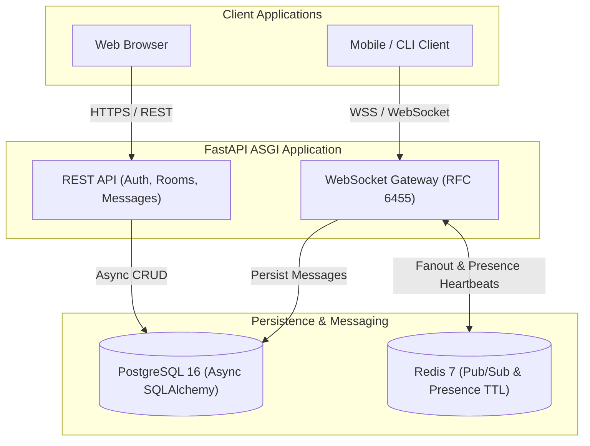

# BaatCheet 💬

> Cloud-Native Real-Time Chat Platform engineered with FastAPI, Redis Pub/Sub, PostgreSQL, and modern DevOps infrastructure.

---

## 🚀 Overview

**BaatCheet** (Hindi: बातचीत, "conversation") is a high-performance, low-latency, multi-room chat platform designed for modern engineering squads and student teams. It delivers RFC 6455 compliant WebSockets, Redis-backed presence tracking and message fanout, and a containerized cloud deployment stack.

---

## 🏗️ Architecture



---

## 🛠️ Technology Stack

| Layer | Technology | Purpose |
| :--- | :--- | :--- |
| **Backend Framework** | FastAPI (Python 3.12) | High-throughput asynchronous ASGI web server |
| **Database** | PostgreSQL 16 | Relational persistence with Async SQLAlchemy & Alembic |
| **Real-time & Cache** | Redis 7 | Distributed Pub/Sub pub/sub message broker & TTL presence |
| **Authentication** | JWT (python-jose) + Argon2 / Passlib | Stateless token authentication with password hashing |
| **Containerization** | Docker (Multi-stage build) | Production runtime image hardening with non-root user |
| **Local Orchestration** | Docker Compose | Local multi-service staging environment |
| **Kubernetes** | K8s Manifests & Helm Charts | Declarative orchestration, rolling updates, health probes |
| **Infrastructure as Code**| Terraform (AWS Provider) | Cloud infrastructure provisioning (VPC, EKS, RDS, ElastiCache) |
| **CI/CD Pipeline** | GitHub Actions | Automated linting, test suite execution, and container build |

---

## 📂 Project Directory Structure

```text
BaatCheet/
├── .github/
│   └── workflows/
│       └── ci-cd.yml          # GitHub Actions CI/CD pipeline
├── backend/
│   ├── app/
│   │   ├── api/               # REST API endpoints (auth, rooms, messages)
│   │   ├── core/              # Configuration & security settings
│   │   ├── db/                # Database connection & async session
│   │   ├── models/            # SQLAlchemy ORM models (User, Room, Message)
│   │   ├── schemas/           # Pydantic schemas for validation
│   │   ├── websockets/        # Connection manager & Redis Pub/Sub integration
│   │   └── main.py            # FastAPI application entrypoint
│   ├── tests/                 # Pytest test suite
│   └── requirements.txt       # Python dependencies
├── docs/                      # Architectural docs, ADRs, PRD, rules, and flowcharts
├── helm/                      # Helm chart for Kubernetes deployment
├── k8s/                       # Raw Kubernetes manifests (Deployment, Services)
├── skills/                    # Vetted agent and developer skills
├── terraform/                 # Terraform configuration files (main.tf, variables.tf)
├── Dockerfile.backend         # Multi-stage Docker build for backend
├── docker-compose.yml         # Local development composition (Backend, Postgres, Redis)
└── README.md
```

---

## ⚡ Quickstart

### Running with Docker Compose

To spin up the entire stack (FastAPI Backend, PostgreSQL, and Redis) with health checks:

```bash
docker compose up -d --build
```

Access the interactive API docs at:
- **Swagger UI**: [http://localhost:8000/docs](http://localhost:8000/docs)
- **ReDoc**: [http://localhost:8000/redoc](http://localhost:8000/redoc)
- **Health Check**: [http://localhost:8000/health](http://localhost:8000/health)

---

## 🔌 API & WebSocket Protocols

### REST Endpoints

- `POST /api/v1/auth/register` — Create a new user account.
- `POST /api/v1/auth/login` — Authenticate and receive JWT access token.
- `GET /api/v1/rooms` — List accessible chat rooms.
- `POST /api/v1/rooms` — Create a new chat room.
- `GET /api/v1/messages/{room_id}` — Fetch historical messages for a room.

### WebSocket Connection

Connect via WebSocket to stream messages and participate in presence tracking:

```text
ws://localhost:8000/ws/chat/{room_id}?token={JWT_TOKEN}
```

#### Message Frames:
- **Send Message**: `{"type": "message", "content": "Hello World"}`
- **Heartbeat Ping**: `{"type": "ping"}` -> receives `{"type": "pong"}`
- **Typing Indicator**: `{"type": "typing", "is_typing": true}`

---

## 🧪 Testing

Run backend tests using pytest:

```bash
cd backend
pytest
```

---

## 🚢 DevOps & Cloud Infrastructure

- **Container Image**: Built using a multi-stage `Dockerfile.backend` ensuring minimum image size and non-root execution.
- **Kubernetes Deployment**: Found in `k8s/deployment.yaml` with liveness/readiness probes and resource constraints.
- **Helm**: Parameterized deployment via `helm/values.yaml`.
- **Terraform**: Provisioning scripts configured in `terraform/main.tf` targeting AWS cloud primitives.
- **CI/CD**: GitHub Actions workflow (`.github/workflows/ci-cd.yml`) automatically executes tests and verifies container builds on every push to `main`.

---

## 📜 License

This project is licensed under the MIT License.
